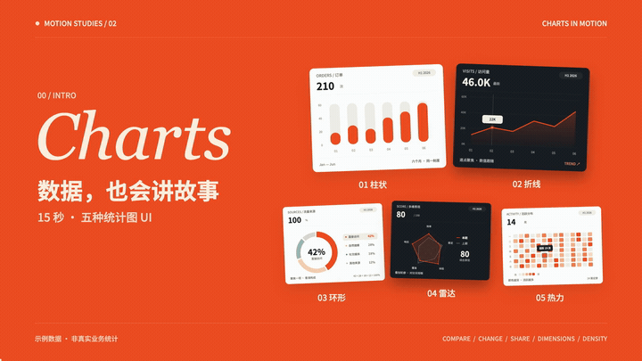
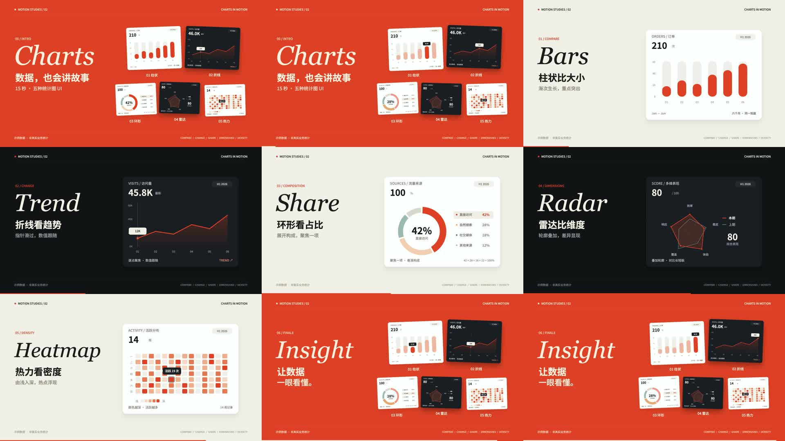

# vibe-charts1 · 图表动效实验室

**15 秒，看懂五种统计图 UI。** 柱状比大小、折线看趋势、环形看占比、雷达比维度、热力看密度。开场与片尾完整展示五种，网页可以亲手操作视频里的效果。

[打开交互演示](https://jdb156158.github.io/vibe-charts1/) · [播放有声视频](https://jdb156158.github.io/vibe-charts1/#film) · [下载 MP4](https://github.com/Jdb156158/vibe-charts1/raw/refs/heads/main/media/charts-motion-15s.mp4) · [下载视频源码](media/charts-motion-source.zip)

## 视频展示

点击动图，打开完整的 15 秒配乐视频。README 动图降低了分辨率和帧率，原片保留 1080p / 60fps。

[](https://jdb156158.github.io/vibe-charts1/#film)

**1920 × 1080 · 60fps · 15.000 秒 · H.264 Main / yuv420p / AAC-LC**。无旁白，短字幕讲解；128 BPM 配乐及音效由 Python 合成。修正版开场与片尾均可看到五种图表及名称。

## 亲手操作

| 图表 | 网页操作 | 与视频对应的效果 |
|---|---|---|
| 柱状 | 悬停、点按月份，或左右按钮 / 方向键 | 柱条渐次生长，单柱聚焦，提示订单数 |
| 折线 | 指针滑过、点按节点，或左右按钮 / 方向键 | 折线绘制，面积渐变，游标与数值联动 |
| 环形 | 悬停 / 点按圆环或图例，或左右按钮 / 方向键 | 扇区展开，选中项加粗，中心占比切换 |
| 雷达 | 点击「上期对比」，或聚焦画布后按回车 / 空格 | 轮廓展开，本期与上期叠加对比 |
| 热力 | 悬停 / 点按格点，或方向键 | 网格按列点亮，格点高亮，查看活跃次数 |

每种图表都支持「重播动效」。顶部标签支持方向键与 Home / End；手机支持点按；遵循系统的减少动态效果设置。网页复用影片中的 Canvas 绘制函数、字体、颜色与数据，视频由时间自动编排，网页由操作控制选中项。

全部数值为**演示数据**，非真实业务统计。

## 提示词与制作步骤

- [完整提示词](docs/PROMPTS.md)
- [制作、重新渲染和部署步骤](docs/MAKING.md)
- [分镜、时间码与示例数据](film/treatment.md)
- [参考来源与授权说明](docs/CREDITS.md)

### 核心提示词

> 参考 BoardUI 的统计图 UI，用代码制作一支 15 秒知识短片。沿用卡片视频的英文衬线大标题、中文短句、纸白和墨黑风格，开头必须使用饱和橙色，第一帧就有画面和大字。依次演示柱状、折线、环形、雷达、热力五种图表，每种只讲一个用途。开头和结尾完整展示五种并标注名称。通过 window.draw(t) 生成确定性 Canvas 动画，逐帧导出，Python 合成配乐和音效，FFmpeg 编码 H.264 + AAC。另做同款可交互网页，复用图表外观与数据，支持悬停、点按、键盘操作和动效重播。交付 MP4、源码、提示词及制作步骤，并发布到 GitHub Pages。

## 本地运行

网页无构建步骤、无需 npm 依赖，在仓库根目录运行：

```sh
python3 -m http.server 8000
```

访问 `http://localhost:8000`。视频渲染需要额外安装 Playwright、numpy、FFmpeg 和 Chrome，详见 [制作步骤](docs/MAKING.md)。

## 文件结构

```text
index.html               交互网页入口
site/style.css           响应式布局与视觉样式
site/charts.js           图表绘制与指针、触摸、键盘交互
film/                    修正版视频完整源码、字体、音频和渲染工具
media/                   MP4、README 动图、封面、总览、视频源码 ZIP
docs/                    提示词、制作步骤与参考来源
.nojekyll                GitHub Pages 静态发布标记
```

## 九帧总览


